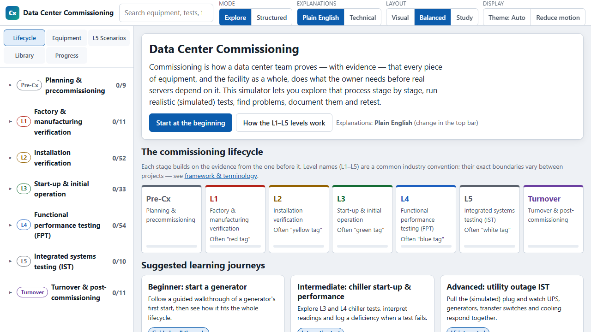

# Data Center Commissioning

**[▶ Launch the simulator](https://samfclement.github.io/Data-Center-Commissioning/)**

An interactive, browser-based educational simulator covering the full commissioning lifecycle of mission-critical data center infrastructure. You plan the tests, run simulated equipment tests, find hidden problems, log deficiencies, retest, and see how every piece of equipment must work together in integrated systems testing.

## What it teaches

Commissioning is how a project team proves, with documented evidence, that each piece of equipment and the facility as a whole meet the owner's requirements before critical IT load depends on them. The simulator follows that process stage by stage:

| Stage | What you do |
|---|---|
| **Planning & precommissioning** | Review owner's project requirements, basis of design, the commissioning plan, submittals and test plans |
| **L1: Factory verification** | Review factory acceptance test records against approved submittals |
| **L2: Installation verification** | Inspect installed equipment with pre-functional checklists |
| **L3: Start-up** | Bring equipment into operation for the first time and check its initial readings |
| **L4: Functional performance testing** | Prove each system performs to its acceptance criteria, including failure modes |
| **L5: Integrated systems testing** | Fail utility power, generators, transfer switches, cooling and controls together, and watch the facility respond |
| **Turnover & post-commissioning** | Issue resolution, turnover package, operational readiness, warranty review, seasonal and ongoing commissioning |

L1–L5 is a common industry convention, not a universal standard. The simulator explains how terminology and level boundaries vary between organizations and projects.

## Equipment covered

- **Electrical power:** utility service, medium- and low-voltage switchgear, transformers, breakers and protective relays, automatic transfer switches, generators and paralleling switchgear, fuel systems, UPS and batteries, static transfer switches, PDUs, remote power panels, rack PDUs, grounding, power quality and EPO.
- **Mechanical & cooling:** water-cooled and air-cooled chillers, pumps and VFDs, cooling towers, dry coolers, heat exchangers and economizers, fan walls, CRAH and CRAC units, valves, strainers, expansion tanks, water treatment, humidity control, containment, thermal energy storage and glycol systems.
- **Controls & monitoring:** BMS, EPMS, PLC controls, temperature/pressure/flow/humidity sensors, control networks and alarm management.
- **Life safety & facility support:** fire alarm interfaces, aspirating smoke detection, suppression interfaces, leak detection, emergency ventilation and environmental controls.

## How you learn

- **Guided walkthrough.** Step through a test with explanations of every action and reading, including example failure situations.
- **Interactive test.** Confirm readiness, run the simulated test, judge each acceptance criterion, decide pass or fail, diagnose hidden faults, log deficiencies and retest after correction. Each run uses a seed, so it can be reproduced exactly.
- **Assessment.** Readiness decisions, reading interpretation and failure diagnosis, with detailed feedback.
- **L5 integrated scenarios.** Ten whole-facility scenarios: utility outage, generator failure, transfer-switch failure, distribution path loss, maintenance-bypass events, chiller and pump failures, BMS communication loss, battery autonomy and a cascading failure. Each has a synchronized timeline you can pause, step forward and back, and replay. You can also change the facility architecture and rerun the same event.
- **Plain English / Technical.** Switch every explanation between beginner-friendly language and technical detail. Abbreviations link to a glossary.
- **Interactive equipment drawings.** Zoom, pan, expand to full screen and inspect labelled components with mouse, touch or keyboard. Drawings change state as the simulation runs.
- **Records and documentation.** Generated test records, deficiency logs and turnover examples, all using a fictitious project.
- **Progress tracking.** Stored only in your own browser, and resettable at any time. Nothing is sent anywhere.

## Offline use

The whole simulator is a single self-contained HTML file with no external dependencies. To use it offline:

1. Open the [simulator](https://samfclement.github.io/Data-Center-Commissioning/).
2. Save the page with your browser's **Save page as…** (choose "Webpage, HTML only" or "Single file"), or download [`index.html`](https://raw.githubusercontent.com/samfclement/Data-Center-Commissioning/main/index.html) directly.
3. Open the saved file in a current version of Chrome, Edge, Firefox or Safari. No internet connection is needed.

## Educational and safety limitations

- **Educational use only.** The simulator never connects to, commands or represents real facility equipment.
- **Not field procedures.** Simulated steps are not methods of procedure. Real switching, energization and testing must follow procedures approved by qualified parties for the specific facility, equipment and applicable codes. Many tests must be performed by licensed or certified specialists and accepted by the authority having jurisdiction.
- **Simplified models.** Equipment models are simplified teaching models. They are not validated against any manufacturer's equipment, and long processes are time-compressed where noted.
- **Labelled acceptance values.** Each numeric criterion is labelled by its basis: conceptual, standard, manufacturer, project or illustrative. Values marked as anything other than "standard" are representative examples, not universal limits. Standards text is summarized, never reproduced.
- **Fictitious data.** All project names, equipment tags and records are fictitious.
